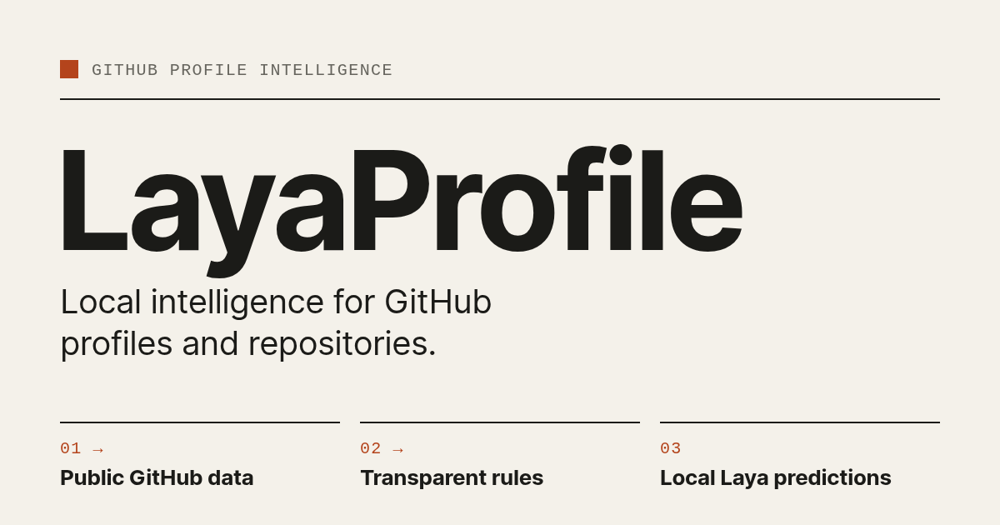

# LayaProfile

**Local intelligence for GitHub profiles and repositories.**



LayaProfile reads the public GitHub data of a developer and turns it into an evidence-based report:
what is there, how well it is presented, and what could be improved. A small local model,
[Laya](https://github.com/NandhaKishorM/laya), adds labelled predictions. Everything runs on your
own machine, and the application works without the model.

## What it does

- **Profile report** at `/user/<name>`: overview, language distribution, repositories created and
  pushed per year, most starred and recently pushed repositories.
- **Profile checklist score**: identity, presentation and maintenance of the public profile, with
  the evidence behind every check, strengths, weaknesses, unknowns and recommendations ordered by
  impact.
- **Repository quality analyzer**: documentation, metadata, maintenance and project structure of a
  single repository, checked on demand (or for the five most recently pushed ones). README checks
  understand English and Persian headings. A project type (library, CLI tool, ...) is suggested.
- **Local Laya predictions**: typed decisions (a choice or a level, never free text) about a README
  and a project. Only confident answers are used, and they are labelled as predictions.
- **Skill evidence**: eight categories (backend, frontend, systems, DevOps, data, mobile, embedded,
  machine learning) built from languages, topics and descriptions, each traceable to the
  repositories it came from.
- **Learning paths**: next steps for six target roles from transparent rules, with no external
  courses or links.
- **Developer comparison** at `/compare/<a>/<b>`: differences in metrics, languages, skill overlap
  and activity per year. There is no winner and no ranking.
- **Share card**: a PNG summary of a profile, drawn in the browser.

## Principles

- **Explainable scores.** Every score is a documented checklist. Each check shows its evidence and,
  when points are missing, a recommendation. Formulas: [docs/SCORING.md](docs/SCORING.md).
- **Unknown is not zero.** Data that is unavailable or cannot be judged leaves the denominator and
  is listed as unknown. Quality and evidence coverage are reported separately.
- **Popularity is not quality.** Stars, forks and followers never enter a score. The comparison
  groups them apart and labels them "popularity, not quality".
- **Laya predictions are gated and labelled.** An answer counts only when its probability reaches a
  per-question threshold, and it is always shown as a model prediction. An uncertain answer is
  ignored, and README text is treated as untrusted data. See [docs/LAYA.md](docs/LAYA.md).

## Architecture

```
 browser ──► Next.js ──────────────► GitHub REST API
             (pages + API routes,
              in-memory cache)
                 │
                 └──────────────────► laya-serve sidecar (optional, local model)
```

- The browser talks only to the application's own `/api/*` routes. GitHub is called from the server,
  with an optional `GITHUB_TOKEN` that never reaches the browser.
- The GitHub layer paginates (at most 300 repositories), caches in memory (LRU with TTL and ETag
  revalidation), serves stale data with a `stale` flag when GitHub fails, and maps errors to typed
  codes. Each client of our own routes is also rate limited.
- Laya is a separate container running the official `laya-serve`. The application calls it with a
  timeout, validates every response and stops calling it for a while after repeated failures.
  Model weights live in a volume, never in an image.
- There is no database. An unavailable Laya only removes the model assessment.

```
pages/        routes: /, /user/[id], /compare/[a]/[b], and pages/api (see "API routes")
components/   report, compare and ui components (styled-components)
lib/github    GitHub REST client, cache, rate limiter, profile and repository evidence loaders
lib/analysis  pure scoring, skill evidence, learning path and comparison modules
lib/laya      laya-serve client, question catalog, gating, circuit breaker, assessment
lib/api       shared wrapper of the API routes (GET only, rate limit, error mapping)
lib/ui        view helpers: formatting, sorting, histogram, share card, API client
e2e/          Playwright specs and a mock GitHub and Laya server
laya/         Dockerfile of the Laya sidecar (no model weights)
docs/         scoring, skills, Laya, deployment and testing documents
eval/         hand-labelled README fixtures for the Laya evaluation (scripts/eval-laya.mjs)
```

## Quick start: development

Requires Node.js 22 (see `.nvmrc`; `package.json` allows 20 or newer).

```sh
npm ci
npm run dev        # http://localhost:3000
```

- **GitHub token (optional).** Without one, GitHub allows 60 requests per hour for the server's IP
  address. A profile load needs a few requests and each repository analysis about five more, so the
  quota runs out quickly. Put `GITHUB_TOKEN=<personal access token>` in `.env.local` (no scopes are
  needed for public data) to get 5000 per hour.
- **Without Laya.** Leave `LAYA_URL` unset, which is the default. Laya is then disabled, nothing is
  requested, and the analysis shows the deterministic scores only.
- **With Laya.** Run the `laya-serve` sidecar (image built from `laya/`, see
  [docs/LAYA.md](docs/LAYA.md) and [docs/DEPLOYMENT.md](docs/DEPLOYMENT.md)) and set
  `LAYA_URL=http://127.0.0.1:8000`.

## Quick start: Docker

The server pulls images that CI published to Docker Hub and never builds. Full instructions,
rollback, GPU and troubleshooting: [docs/DEPLOYMENT.md](docs/DEPLOYMENT.md).

```sh
git clone https://github.com/Liwyd/layaprofile.git && cd layaprofile
cp .env.example .env     # set DOCKERHUB_NAMESPACE; GITHUB_TOKEN and LAYA_API_KEY are recommended
scripts/deploy.sh        # pull, start, wait until the app is healthy
```

The app is then served on port 3000. The first start of the Laya container downloads the English
checkpoint into the `laya-hf-cache` volume, which takes minutes. The app is usable meanwhile and
shows the deterministic analysis. To run without Laya, see "Running without Laya" in the deployment
document.

## Configuration

`.env.example` documents every variable. Docker Compose reads `.env`, and a local run reads
`.env.local`. Never commit real values.

| Variable | Used by | Default | Purpose |
|---|---|---|---|
| `GITHUB_TOKEN` | app | unset | GitHub token for API calls. Raises the limit from 60 to 5000 requests per hour. Server only. |
| `GITHUB_API_BASE` | app | `https://api.github.com` | GitHub REST base URL (GitHub Enterprise Server, or a mock server in tests). |
| `TRUST_PROXY` | app | unset | Set to `1` only behind a reverse proxy you control that sets `X-Forwarded-For`, so each visitor is rate limited separately. |
| `LAYA_URL` | app | unset (`http://laya:8000` in Compose) | Base URL of `laya-serve`. Unset or empty disables Laya. |
| `LAYA_API_KEY` | app, Laya | unset | Shared secret sent as `Authorization: Bearer` and required by the Laya server. Empty means no authentication. |
| `LAYA_TIMEOUT_MS` | app | `20000` | Time to wait for one Laya request. |
| `LAYA_DEVICE` | Laya | `cpu` | `cpu` or `cuda` (needs a GPU image build). |
| `LAYA_THREADS` | Laya | `2` | Cap on CPU threads. |
| `LAYA_MODELS` | Laya | `english` | Checkpoints to load: `english`, `multilingual` or both, comma separated. |
| `HF_HUB_OFFLINE` | Laya | `0` | Set to `1` after the first download to run without Hugging Face access. |
| `DOCKERHUB_NAMESPACE` | Compose | required | Docker Hub account that publishes the images. |
| `LAYAPROFILE_TAG` | Compose | `latest` | Image tag to run (`latest`, `1.2.3`, `sha-1a2b3c4`). |
| `APP_PORT`, `APP_BIND` | Compose | `3000`, `0.0.0.0` | Host port and interface of the app. Use `127.0.0.1` behind a reverse proxy. |
| `COMPOSE_PROFILES` | Compose | `laya` (in `.env.example`) | `laya` starts the Laya container. Empty runs the app alone. |
| `NEXT_PUBLIC_SITE_URL` | image build | empty | Public site URL for the absolute Open Graph image address. Inlined at build time. |

`DOCKERHUB_TOKEN` is read by `scripts/deploy.sh` from your shell for private images. Keep it out of
`.env`, which is passed to the app container.

## API routes

All routes answer JSON. Errors use `{ "error": { "code", "message" } }` with an HTTP status that
matches (400 invalid input, 404 not found, 429 rate limited, 502 or 504 for GitHub failures). Every
route except `/api/health` is GET only and rate limited per client.

| Method | Path | Purpose |
|---|---|---|
| GET | `/api/profile/[user]` | Profile, repositories (at most 300), profile checklist score and skill evidence. |
| GET | `/api/repos/[user]/[repo]/analysis` | Repository score, project type and Laya assessment. A normal 200 even when Laya is unavailable. |
| GET | `/api/repos/[user]/[repo]/evidence` | Raw collected evidence: repository, README text, top-level file list, latest release, languages. |
| GET | `/api/compare?a=<user>&b=<user>` | Comparison of two profiles. |
| GET | `/api/learning-path/[user]?role=<role>` | Learning path for `backend`, `frontend`, `fullstack`, `devops`, `systems` or `data-engineering`. |
| GET, HEAD | `/api/health` | Liveness of the app, whether a GitHub token is set, the rate limit seen, and the Laya status. Exposes no secrets. |

## Testing

```sh
npm test                  # unit and integration tests (Vitest), Node only
npm run test:e2e          # Playwright against the production build, GitHub and Laya mocked
npm run lint              # ESLint
npx prettier --check .    # formatting (CI runs it too)
npm run build             # production build
```

The end-to-end suite needs Chrome or Chromium, builds the application when it is out of date and
never touches the network. Details: [docs/TESTING.md](docs/TESTING.md).

## Documentation

| Document | Contents |
|---|---|
| [docs/SCORING.md](docs/SCORING.md) | Every score: criteria, weights, formulas, labels, missing-data rules. |
| [docs/SKILLS.md](docs/SKILLS.md) | Skill evidence, learning path rules and the comparison. |
| [docs/LAYA.md](docs/LAYA.md) | Laya runtime, question catalog, gating, failure behaviour, evaluation. |
| [docs/DEPLOYMENT.md](docs/DEPLOYMENT.md) | Docker Compose deployment, CI and image tags, rollback, GPU, troubleshooting. |
| [docs/TESTING.md](docs/TESTING.md) | Unit and end-to-end tests, the mock server, CI failures. |
| [eval/README.md](eval/README.md) | The labelled README fixtures used to evaluate Laya. |

## Known limitations

- **Laya is not measured yet.** No accuracy, latency or memory figure exists, and the confidence
  thresholds (0.80, 0.60 and 0.50 depending on the question) are provisional. The evaluation set is
  30 fixtures labelled by one person. Laya also sees only the beginning of a long README.
- **The Docker images and the sidecar have not been exercised end to end.** The Compose memory and
  CPU limits are provisional.
- **Only the top level of a repository's file tree is inspected.** Tests, CI or documentation in
  subdirectories are not seen, and the result says "not found at the repository root".
- **Pinned repositories are unavailable.** They need GitHub GraphQL and a token, so the profile
  checklist lists them as unknown and never counts them against the profile.
- **The contribution calendar and commit history are not implemented.** There is no GraphQL code,
  and `GITHUB_TOKEN` only raises the REST rate limit. The activity chart shows the years in which
  repositories were created and last pushed, which are repository dates and not contributions.
- **Language shares are repository counts,** by each repository's primary language, not a share of
  code written, and they are not skill percentages.
- **Skill evidence and learning paths use the repository list only** (languages, topics,
  descriptions). Evidence from dependency manifests and file-based checks is supported by the
  modules but no route feeds them yet. Laya's skill category question is defined but no route asks
  it.
- **Only the 300 most recently pushed repositories are loaded.** A notice appears for larger
  accounts.
- **The in-memory cache resets on restart** and is not shared between processes.
- **The unauthenticated GitHub quota is 60 requests per hour per server IP address,** shared by all
  visitors of the instance. Set `GITHUB_TOKEN` for a real deployment.

## Credits and license

- Built on [OctoProfile](https://github.com/bchiang7/octoprofile) by Brittany Chiang (MIT). Its
  copyright notice is kept in [LICENSE](LICENSE).
- [Laya](https://github.com/NandhaKishorM/laya) by NandhaKishorM (Apache-2.0) provides the local
  decisions. It runs as a separate container (`laya[serve]` from PyPI, installed by
  `laya/Dockerfile`) and is not vendored in this repository.
- Inter (`public/assets/fonts/Inter`) is copyright The Inter Project Authors, under the SIL Open
  Font License 1.1 (`public/assets/fonts/Inter/LICENSE.txt`). No monospace font is bundled:
  monospace text uses the platform's own font (`ui-monospace` and fallbacks).

LayaProfile is released under the MIT License.

> Copyright (c) 2019 Brittany Chiang (original OctoProfile)
> Copyright (c) 2026 LayaProfile contributors

The full permission notice is in [LICENSE](LICENSE) and must be included in all copies or
substantial portions of the software.
